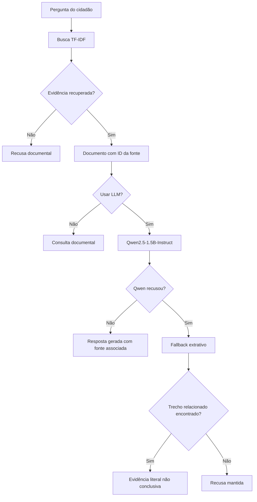

# Passo Firme — Relatório Técnico de IA Generativa

## 1. Identificação

Disciplina: Generative AI for Engineering

Projeto: Passo Firme — CitizenTech

Integrantes: 
Kaique Maia Reis Silva RM552112
Orlando Akio Morii Cardoso RM98067
Pedro Henrique Alves Guariente RM550301
David de Medeiros Pacheco Junior RM551462

## 2. Problema e objetivo

O Passo Firme busca apoiar a mobilidade acessível
em São Paulo, oferecendo informações sobre
responsabilidades e conservação de calçadas.

O componente de IA utiliza uma LLM aberta,
uma base documental e mecanismos de recuperação
de informações para responder a perguntas.

O objetivo experimental é comparar:
1. LLM sem contexto;
2. LLM com RAG;
3. LLM com RAG e agente de recuperação.

## 3. Arquitetura

Fluxo experimental:

Pergunta do usuário
→ Busca semântica ou híbrida
→ Seleção de documentos
→ LLM Qwen
→ Validação do JSON e das fontes
→ Resposta

O agente acrescenta uma ferramenta de busca
por termos específicos quando a busca principal
não encontra evidências suficientes.

Qwen foi integrada opcionalmente à API e executada em CPU. 
A integração com o MVP principal ainda precisa ser comprovada.

### Diagrama do pipeline da API

O pipeline experimental do notebook também
compara três configurações:

1. Qwen sem contexto;
2. Qwen com RAG e busca híbrida;
3. Qwen com RAG e agente de recuperação.

O fallback da API recupera trechos relacionados,
mas não comprova automaticamente a correção
factual da resposta.

## 4. Tecnologias

- Python e PyTorch
- Qwen2.5-1.5B-Instruct
- Hugging Face Transformers
- Sentence Transformers
- Embeddings multilíngues MiniLM
- TF-IDF e busca híbrida
- FastAPI
- Google Colab

## 5. Base de conhecimento

Base inicial: 5 trechos resumidos.

Fontes documentais:
- Lei Municipal 15.442/2011
- Decreto Municipal 59.671/2020

Formato: JSON

Os trechos são resumos usados para prototipação,
não transcrições literais.

É necessário verificar os textos consolidados,
o enquadramento jurídico, as licenças e a
correspondência entre artigos e resumos.

### Tabela da base documental

| Fonte | Formato de origem | Formato armazenado | Licença | Trechos |
|---|---|---|---|---:|
| Lei Municipal 15.442/2011 | Página de legislação oficial | JSON com resumo manual | Licença específica não identificada | 4 |
| Decreto Municipal 59.671/2020 | Página de legislação oficial | JSON com resumo manual | Licença específica não identificada | 1 |
| **Total** | | | | **5** |

Os cinco registros contêm identificador,
referência normativa, URL e resumo textual.

Os resumos não são transcrições literais.
A ausência de uma licença identificada
não significa que a reutilização irrestrita
tenha sido autorizada.

Detalhamento das fontes:
[base/FONTES.md](base/FONTES.md)

## 6. Conjunto de testes

15 perguntas com gabarito:
- 10 com respostas esperadas na base;
- 5 cuja resposta não consta na base.

Os testes iniciais também foram utilizados
para ajustar os pesos e os limiares da busca.

Portanto, as métricas são preliminares.

## 7. Resultados de recuperação

Busca semântica:
- Recall@1: 80%
- Recall@3: 90%

Busca híbrida sem filtro:
- Recall@1: 90%
- Recall@3: 100%

Busca híbrida com limiar 0,26:
- Fontes esperadas recuperadas: 9/10
- Perguntas sem resposta rejeitadas: 5/5

O limiar foi escolhido empiricamente nos
testes iniciais e não foi validado em uma
amostra independente.

## 8. Comparação das configurações

LLM sem contexto:
- 15 perguntas executadas
- 14/15 JSONs originalmente válidos

RAG simples:
- 15 perguntas avaliadas
- 9 chamadas à LLM
- 4/9 JSONs originalmente válidos
- 5/5 recusas corretas do sistema
- 1 recusa indevida

RAG com agente:
- 15 perguntas avaliadas
- 10 chamadas à LLM
- 5/10 JSONs originalmente válidos
- 5/5 recusas corretas do sistema
- 0 recusas indevidas

As recusas por filtro são decisões do sistema,
não respostas geradas pela LLM.

A normalização de JSON e fontes foi feita
em uma etapa separada.

Ainda não há avaliação factual completa
nem taxa definitiva de alucinação.

## 9. Análise de erros

Foram documentados cinco erros observados:
1. Informações não fundamentadas;
2. Fonte inventada;
3. JSON com formatação Markdown;
4. Citação fora do padrão;
5. Recusa indevida.

Detalhes, causas prováveis e correções estão em:
avaliacao/analise_5_erros.md

## 10. API e integração da LLM

Endpoints implementados:
- GET /health
- POST /buscar
- POST /assistente

O endpoint /assistente oferece dois modos:

1. Consulta documental, sem LLM (padrão).
2. Geração com Qwen2.5-1.5B-Instruct,
   ativada pelo parâmetro usar_llm=true.

A Qwen foi executada de verdade na CPU
do Google Colab por meio da API FastAPI.

### Resultados observados

- Carregamento real da Qwen: concluído.
- Resposta HTTP: 200.
- 8 testes automatizados executados em conjunto.
- Resultado: 8 aprovados, 0 falhas, 11,912 segundos.
- 2 testes de fallback com respostas simuladas.
- O teste automatizado de integração simula a Qwen.
- A execução real da Qwen foi validada separadamente.

### Falha identificada

Na pergunta sobre a responsabilidade dos
condomínios, a Qwen recusou indevidamente
a resposta, apesar da evidência existente.

A alteração do prompt não resolveu o erro.

### Correção implementada

Foi desenvolvido um fallback extrativo.

Quando a Qwen recusa, o sistema procura
evidências textuais relacionadas à pergunta.

No teste real, o fallback recuperou:

"Entre os responsáveis pela manutenção estão
proprietários, possuidores e condomínios."

Fonte: lei_15442_art10.

A evidência foi validada literalmente
contra o documento recuperado.

O fallback apresenta um trecho documental,
sem afirmar que a resposta é conclusiva.

### Limitações

Os testes demonstram funcionamento técnico,
mas não comprovam precisão factual geral.

O fallback utiliza coincidência de palavras
e pode recuperar trechos pouco relevantes.

A integração com o MVP principal do grupo
ainda não foi demonstrada.

## 11. Limitações

- Base documental pequena;
- Resumos legais pendentes de revisão;
- Testes utilizados durante calibração;
- Falta avaliação independente;
- Resultados individuais parcialmente perdidos
  após reinicialização do Google Colab;
- Integração da API ao MVP principal pendente;
- Não foi comprovada uma redução geral da
  taxa de alucinação.

## 12. Conclusão técnica

O protótipo demonstrou o funcionamento de
uma LLM local, recuperação documental,
busca híbrida e um agente com ferramentas.

O agente recuperou a fonte da pergunta sobre
condomínios, que havia sido rejeitada pelo
RAG simples.

Os experimentos identificaram problemas
de recuperação, citação e formatação JSON.

A melhoria observada na recuperação não
comprova, isoladamente, maior precisão
factual ou menor alucinação.

## 13. Links

GitHub: https://github.com/kaiquemaiareis/Passo-Firme-IA
MVP: PREENCHER
Vídeo de demonstração: PREENCHER
